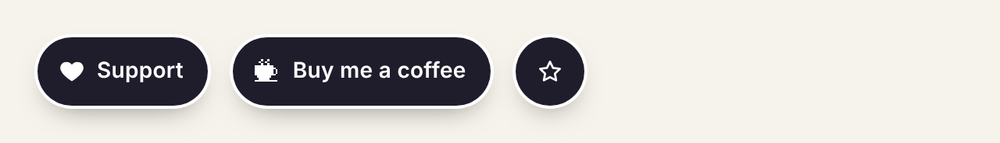
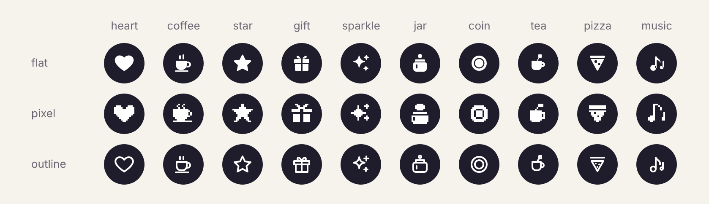
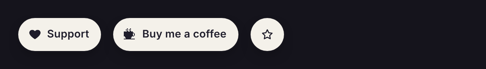

# tipjar

A small floating tip button for Ko-fi, Buy Me a Coffee, GitHub Sponsors or any link. It sits in a corner of the page, folds to just its icon on a phone, and can tuck itself away when your footer, with its own support link, scrolls into view.

- **Zero dependencies, about 13 kB gzipped** with the stylesheet. A function that returns an HTML string, one CSS file, and an optional `mount()` for the browser.
- **Works under a strict CSP.** No inline scripts, and no inline styles unless you ask for them. Theme it with CSS custom properties.
- **Its own icons.** Ten of them, each drawn flat, pixel or outline, all in `currentColor`, and each with a part that moves on hover. Or bring your own SVG.
- **Accessible.** A real link with a name that includes its visible text, a 44px target, a visible focus ring, and no motion for people who ask for less.



```sh
npm i tipjar
```

## Use it

In the browser:

```js
import { mount } from 'tipjar';
import 'tipjar/style.css';

mount({
  href: 'https://ko-fi.com/you',
  description: 'this project on Ko-fi', // read after "Support" by screen readers
  icon: 'coffee',
  iconStyle: 'pixel',
  hideWhenVisible: 'footer',
});
```

On the server, or in any template, `tipjar()` returns the markup:

```js
import { tipjar } from 'tipjar';

const html = tipjar({ href: 'https://github.com/sponsors/you', label: 'Sponsor', icon: 'heart' });
```

Copy `node_modules/tipjar/style.css` next to your other stylesheets if you don't use a bundler.

[docs/recipes.md](docs/recipes.md) has short recipes for React, Vue, Svelte, Astro, Next.js and plain HTML with no build step, and notes for sites with a strict CSP.

## Options

| Option | Default | |
| --- | --- | --- |
| `href` | (required) | http, https, mailto or a relative URL. Anything else throws, so the button can't run script. |
| `label` | `"Support"` | The visible text. |
| `description` | none | Extra words for screen readers, read after the label. |
| `icon` | `"heart"` | `heart`, `coffee`, `star`, `gift`, `sparkle`, `jar`, `coin`, `tea`, `pizza`, `music`; `false` for none; or `{ svg: '<svg…>' }` for your own. Custom SVG is inserted as is, so only pass markup you trust. |
| `iconStyle` | `"flat"` | `flat`, `pixel` or `outline`. |
| `position` | `"bottom-right"` | `bottom-left`, `top-right`, `top-left`, or `inline` to flow with the page. |
| `compact` | `"auto"` | When to show only the icon: `auto` (under 600px wide), `always`, `never`, or `hover`: a circle that opens into the full button on hover or keyboard focus, and stays a circle on touch screens. |
| `hover` | `"lift"` | What the whole button does on hover: `lift`, `pop` (a springy grow), `wiggle` (a quick tilt), `shine` (a highlight sweeps across), `fill` (a second colour wipes in) or `none`. The icon's own movement is `animate`. With `compact: 'hover'`, opening is the hover effect, so the button doesn't lift, pop or wiggle; shine and fill still play. |
| `animate` | `"hover"` | When an icon's moving parts play (the heart's beat, the coffee's steam and so on): `hover` (also on keyboard focus), `loop` (three times when the page loads, and on hover) or `none`. |
| `enter` | `"none"` | An entrance when the page loads: `fade`, `slide` or `pop`, after `--tipjar-enter-delay` (0.6s). |
| `newTab` | `false` | Open the link in a new tab, with `rel="noopener"`. Screen readers hear the `newTabHint` after the label. |
| `newTabHint` | `"(opens in a new tab)"` | With `newTab`, words read to screen readers so people know a tab will open. Translate it, or `''` for none. |
| `look` | none | `{ background, label, icon, radius }` written as inline custom properties. Leave it out on strict-CSP sites. |
| `className` | none | More classes for the link. |

`mount()` also takes `target` (default `document.body`), `hideWhenVisible` and `nudgeAfter`. It returns `{ element, destroy }`.

## Tuck it away

`hideWhenVisible` hides the button while any of the elements it names is on screen, usually a footer with its own support link. It takes an element, a selector (every match is watched) or a list of elements. A selector is looked up once, when the button mounts, so run it after the footer is on the page; if nothing matches, tipjar warns in the console and the button keeps showing.

For a button that's already on the page, such as `tipjar()` markup rendered on the server or by a static site generator, use `tuck()`:

```js
import { tuck } from 'tipjar';

const untuck = tuck(document.querySelector('.tipjar'), 'footer, .support-links');
// Later, to stop watching and show it again:
untuck();
```

A tucked button gets `data-tucked`, which hides it and takes it out of the tab order.

## Icons

Ten icons, each drawn three ways, all in `currentColor`:



Pixel icons sit on a 12×12 grid, so they're sharpest at 12, 24 or 48px. At the default 16px each cell is a pixel and a third, so on a sharp-edged pixel icon the steps come out a little uneven; set `--tipjar-icon-size: 24px` if you use them.

Every icon has a moving part, which plays on hover by default (see `animate`): the heart beats, steam rises from the coffee and drifts up past the button's edge, the star turns, the gift's lid hops, the small sparkles twinkle, a coin drops into the jar, the coin flips, the tea bag's tag swings, the pizza slice pulls away, and a note floats up from the music. Pixel icons move a whole cell at a time, so a pixel star pulses instead of turning, and a pixel tag sways. In a compact button, a bigger icon such as `--tipjar-icon-size: 28px` shows them off, and `--tipjar-accent` colours the moving parts.

`icon(name, style)` returns a single icon as an SVG string, and `ICON_NAMES` and `ICON_STYLES` list them.

## Nudge

`nudgeAfter: 20` gives the button one small wiggle after 20 seconds, with its icon's part playing once, to catch the eye. It happens at most once per visit (it notes this in `sessionStorage`, only for this tab), never while the button is tucked away or the tab is hidden, never once someone has hovered or focused the button, and never for people who ask for less motion.

For a button that's already on the page, use `nudge()`, which returns a function that cancels it:

```js
import { nudge } from 'tipjar';

const cancel = nudge(document.querySelector('.tipjar'), 20);
```

## Referrer

The link doesn't add `rel="noreferrer"`, so Ko-fi, Buy Me a Coffee and the like can see which site a tip came from, which many people want. What they see follows your site's referrer policy; browsers default to sending only your origin (`https://you.dev/`), never the full page URL. To send nothing, set a `Referrer-Policy: no-referrer` header or `<meta name="referrer" content="no-referrer">` on your site.

## Theme it

Set any of these on `.tipjar` or an ancestor, such as `:root`:

```css
:root {
  --tipjar-bg: #3a26c9;         /* fill */
  --tipjar-label: #fff;         /* text */
  --tipjar-icon: currentColor;  /* icon */
  --tipjar-ring: #f6f3ec;       /* ring of page colour around the button */
  --tipjar-radius: 999px;
  --tipjar-font: inherit;
  --tipjar-font-size: 0.875rem;
  --tipjar-weight: 600;
  --tipjar-size: 44px;          /* height, and width when compact */
  --tipjar-icon-size: 16px;
  --tipjar-offset: 16px;        /* distance from the screen edges */
  --tipjar-z: 50;
}
```

There are also `--tipjar-gap`, `--tipjar-pad`, `--tipjar-tracking`, `--tipjar-border`, `--tipjar-shadow` and `--tipjar-focus`. For the motion options: `--tipjar-accent` (the colour of an icon's moving parts, such as steam or a coin; by default the icon's), `--tipjar-shine` (the `shine` highlight), `--tipjar-fill` (the `fill` colour, by default the fill mixed with a little of the label) and `--tipjar-enter-delay`.

### Motion

Hover effects only run on devices that can hover, so nothing sticks after a tap; a tap gets a small squish instead. Everything is CSS, so it works under a strict CSP. For people who turn on reduced motion there is no lift, pop, wiggle, sweep, squish or entrance, and a `compact: 'hover'` button opens at once instead of sliding.

### Dark mode

Out of the box the button is dark on a light page and light on a dark one, following `prefers-color-scheme`. The dark defaults only replace tipjar's own fallbacks, so any `--tipjar-*` value you set still wins in both.

| Light | Dark |
| --- | --- |
|  |  |

If your site themes with a class or attribute instead of the media query, set the variables there:

```css
/* Your dark theme */
[data-theme="dark"] {
  --tipjar-bg: #f4f1ea;
  --tipjar-label: #1f1d2b;
  --tipjar-ring: #15141c; /* your page colour */
}
/* Keep the light look even when the visitor's system is dark */
[data-theme="light"] {
  --tipjar-bg: #1f1d2b;
  --tipjar-label: #ffffff;
  --tipjar-ring: #ffffff;
}
```

Both default looks pass WCAG AA with room to spare: the label is 16.6:1 on light and 14.7:1 on dark.

In forced-colours mode (Windows High Contrast), where fills and shadows are removed, the button gets a border and its icon and label take the system link colour.

## Stability

From 1.0, tipjar follows [semver](https://semver.org): anything that could break a working button needs a major version. That covers:

- **Exports:** `tipjar`, `mount`, `tuck`, `nudge`, `icon`, `ICON_NAMES`, `ICON_STYLES`, and the exported types.
- **Options:** their names, accepted values and defaults, including the fixed 600px `compact: 'auto'` breakpoint.
- **Markup:** the `.tipjar`, `.tipjar-icon`, `.tipjar-label` and `.tipjar-sr` classes, and the `data-position`, `data-compact`, `data-hover`, `data-enter`, `data-animate`, `data-nudge` and `data-tucked` attributes, so your CSS can rely on them.
- **Custom properties:** every `--tipjar-*` name in [Theme it](#theme-it).
- **Icon drawings:** redrawing a built-in icon is a major version. Fixing a rendering bug in one, such as a stray pixel, is a patch, and both are noted in CHANGELOG.

Not covered, and free to change in a minor or patch release with a CHANGELOG note:

- Exact default colours, shadow, spacing and font size, as long as contrast stays at WCAG AA or better. Set the `--tipjar-*` properties to pin a look.
- Anything else in the markup, such as attribute order, the private `--_*` properties, or the icon's SVG path data.
- The wording of error and warning messages.
- New options, icons, exports and custom properties, which come in minor versions.

## Releasing

`npm run release -- 0.2.0` moves the CHANGELOG's [Unreleased] entries under a dated 0.2.0 heading and sets the version. Open that as a PR; merging it makes `.github/workflows/release.yml` publish to npm with provenance, tag `v0.2.0` and create the GitHub release. Pushing a `v*` tag by hand does the same. Publishing uses npm trusted publishing, so no token is stored.

## Licence

MIT. The icons are tipjar's own drawings and ship under the same licence. Brand logos are left out on purpose; pass them with `icon: { svg }` if their owners allow it.
